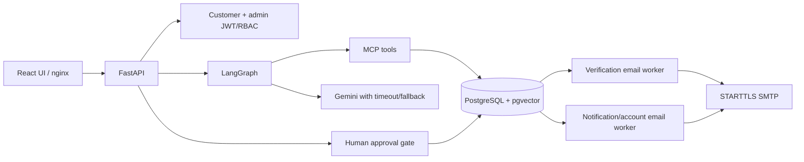

# SupportFlow AI

SupportFlow AI is a customer-support portfolio application with customer and administrator authentication, verified-email onboarding, LangGraph orchestration, Gemini-backed routing and responses with safe local fallbacks, pgvector RAG, MCP business tools, human approval gates, notifications, audit history, and Option A account anonymization.

## Architecture



New clones use a Compose-managed PostgreSQL database (`supportflow_db`) and their own credentials. Existing deployments may use a private recovery override, which must never be used for first-install bootstrap. Automated tests use only `supportflow_test_db` and disposable `sf_*` schemas.

## Prerequisites

- Windows with Docker Desktop and Docker Compose v2
- A private `.env` based on `.env.example`; never commit it
- Python 3.12 and Node 22 only for host-side development/testing

## Docker startup

```powershell
Copy-Item .env.example .env
# Edit .env: set POSTGRES_PASSWORD, JWT_SECRET_KEY, ADMIN_TOKEN and other secrets.
docker compose config --quiet
docker compose build
docker compose up -d --wait
docker compose exec backend python -m scripts.bootstrap_admin --email you@example.com
```

The bootstrap command prompts twice for the password (using a hidden prompt),
creates exactly one active `super_admin`, and refuses protected/test databases or
any database that already has a Super Admin. It has no
public endpoint and never accepts a password argument. Subsequent administrators
must be created through the authenticated Super Admin management UI/API.

For an existing private deployment, copy `compose.recovery.example.yaml` to the
ignored `compose.recovery.yaml`, keep its recovery URL/credentials in the
private `.env`, and start with `docker compose -f compose.yaml -f compose.recovery.yaml up -d --wait`.
Do not run the bootstrap command there. The Compose-managed local `postgres`
service is for new clones.

Open `http://localhost:5173`; backend health is `http://localhost:8000/health`.

Browser routes are bookmarkable: `/` starts a new customer conversation, `/chat/<ticketId>` restores an owned conversation, `/admin` opens the dashboard, and `/admin/customers`, `/admin/tickets`, and `/admin/administrators` select their authorized admin sections. Nginx falls back to `index.html` for deep-link refreshes; the API remains the authorization boundary.

Email delivery is intentionally disabled by default. The normal Compose stack starts both workers in a safe idle mode; while disabled they make zero database or SMTP calls:

```powershell
docker compose run --rm verification-email-worker python -m app.verification_entrypoint --check
docker compose run --rm notification-email-worker python -m app.email_entrypoint --check
docker compose up -d --wait
docker compose ps
```

If ports are occupied, set `BACKEND_PORT`, `FRONTEND_PORT`, and `PUBLIC_API_URL` consistently before building. Stop application containers with:

```powershell
docker compose stop

Workers remain idle while `EMAIL_DELIVERY_ENABLED=false`. Enabling delivery is
a separate, explicitly approved change because pending/retry rows may then be
claimed. A running worker is not proof of SMTP inbox delivery; the default
workflow never sends real email.

Email modes are explicit: `EMAIL_DELIVERY_MODE=test` requires the private
`EMAIL_TEST_ALLOWED_RECIPIENTS` list at the SMTP envelope boundary; `production`
permits only recipients selected by authenticated application records. Invalid
or missing mode/allowlist configuration fails closed. Production mode is never
enabled implicitly.
```

Never add `--volumes` or `--remove-orphans`; historical PostgreSQL containers and volumes are intentionally preserved.

## Configuration and operations

See [docs/OPERATIONS.md](docs/OPERATIONS.md) for placeholder-only configuration, container/volume inventory, backups, rollback, migrations, tests, and evaluation. Secrets are loaded at runtime through `.env`; neither Dockerfile embeds them.

## Testing

```powershell
.\.venv\Scripts\python.exe -m pytest -q
cd frontend
npm.cmd test -- --reporter=dot
npm.cmd run build
```

Tests refuse unsafe database names and use `supportflow_test_db` only. SMTP and provider calls are mocked unless a separate command explicitly opts into them.

DeepEval dry-run validation (zero judge calls):

```powershell
.\.venv\Scripts\python.exe evaluation\deepeval_runner.py --dataset evaluation\examples.synthetic.jsonl
```

Live judging is optional, sanitized, quota-consuming, and documented in `evaluation/README.md`. Results are recorded in [evaluation/REPORT.md](evaluation/REPORT.md); no unexecuted score is presented as measured.

## Security model

- Short-lived customer/admin JWTs include session versions for password-change/logout revocation.
- Database-backed admin roles enforce admin/super-admin boundaries.
- Every order lookup is scoped to the authenticated customer.
- Refund/cancellation requests remain pending until an authorized human decision; no financial transfer is implemented.
- Option A invalidates access and anonymizes identity while retaining linked support and audit history.
- Email outboxes use leases, `SKIP LOCKED`, claim tokens, retry limits, uniqueness, and terminal recipient redaction.
- Verification links are one-time, expiring, encrypted at rest in the delivery queue, and never logged.

## Known limitations

- Live SMTP delivery, inbox placement, browser-driven disposable-account journeys, and live Gemini/DeepEval judging require external credentials and were not executed in the final automated run.
- PostgreSQL remains externally managed so Compose cannot restart it; this avoids modifying recovered infrastructure.
- Migration SQL is ordered but not managed by a version ledger/Alembic. Apply it only after a verified private backup.
- Repository-wide Ruff reports pre-existing style debt; risky bulk auto-formatting was intentionally avoided.
